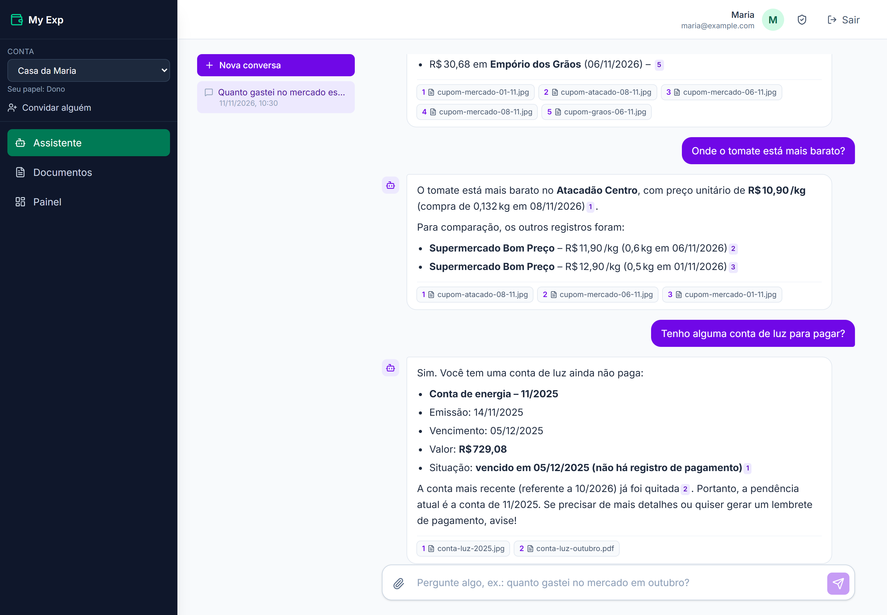
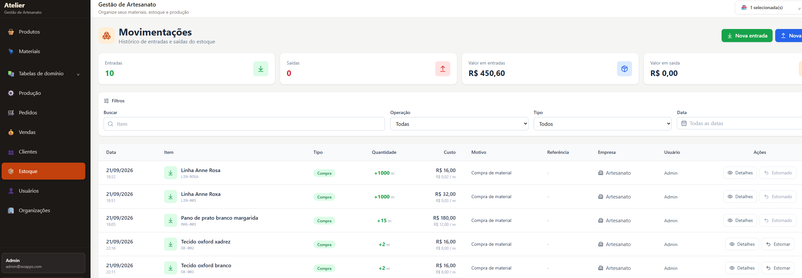
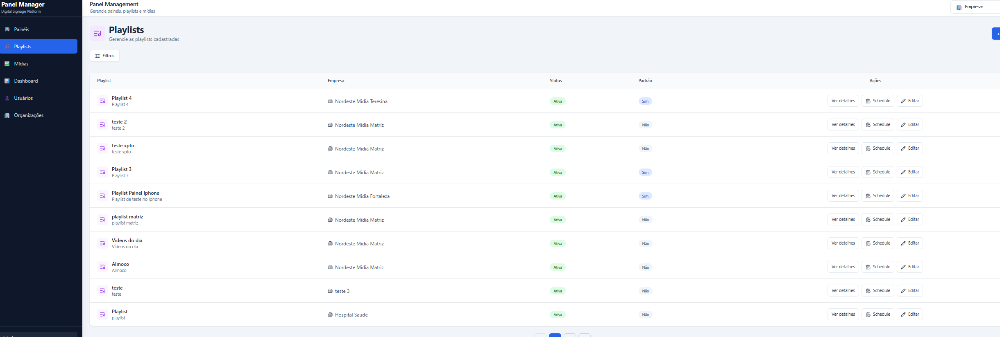

# Hi there 👋

I'm a **Software Developer** focused on building full-stack applications, backend systems, and production-ready software.

I enjoy turning ideas into real products, working across the entire development lifecycle — from designing and developing applications to testing, deployment, and infrastructure.

> 🔒 **Proprietary Software & Production Safety:** To protect production infrastructure from unauthorized access, automated scanning, and malicious requests, all direct URLs, endpoints, and credentials for my live SaaS applications are kept strictly private. Below is the architectural and engineering breakdown of the production-ready systems I design, build, and maintain.

---

## 🚀 Live SaaS Products & Applications

### 🤖 My Exp (AI Expense Assistant)
An **AI assistant for family finances**: snap a photo of a supermarket receipt or upload a utility bill, then just ask — *"How much did I spend on groceries this month?"*, *"Where is tomato cheapest?"*, *"Do I have any bills to pay?"*. Every answer comes with the numbers **and links to the receipts they came from**. Built for my family, starting with my mom, who kept every receipt in a notebook.

* **🟢 Status:** Deployed and active in production (private); source code published as a showcase.
* **📦 Source:** [github.com/marvini86/my-exp](https://github.com/marvini86/my-exp) — architecture, deployment guide and tests.

#### 🛠️ Core Architecture & Tech Stack
* **Backend API & Worker:** Python • FastAPI • SQLAlchemy • Pydantic • LangChain • PostgreSQL (Row-Level Security) • Qdrant (vector search)
* **Frontend App:** Next.js (App Router, Server Components & Server Actions) • TypeScript • Tailwind CSS • OpenAPI-generated client
* **AI:** Multimodal vision LLMs (receipt reading) • Embeddings & RAG • Tool use • Free-tier models (Gemini, Groq, Cloudflare Workers AI, OpenRouter) behind a router with fallback
* **Cloud & Infrastructure:** Oracle Cloud ARM VM • Docker • Caddy (automatic HTTPS) • Azure Blob Storage • Google Sign-In
* **CI/CD & DevOps:** GitHub Actions (tests → ARM images → SSH deploy) • AI evaluations outside CI

#### 🏗️ System Components & Engineering Highlights
* **Document ingestion pipeline:** a worker reads photos, PDFs and NF-e XML (vision LLM or deterministic XML parser), validates the 44-digit access key, re-reads with another model when the items don't add up to the total, deduplicates the same receipt sent twice, and builds the knowledge base (PostgreSQL + Qdrant).
* **The LLM never writes SQL or does math:** a planner turns the question into a fixed intent + parameters, parameterized SQL computes the facts, and a second call writes the answer — with every `[D1]` citation verified by code.
* **Product understanding:** receipts abbreviate everything (`CSCOX LAR C/DORSO` is chicken); an AI step maps each item to a readable name and product group, cached per account, powering answers like *"how much did I spend on produce?"*.
* **Free AI that keeps working:** multi-provider routing with per-model and per-provider cooldowns; when every free quota is exhausted, jobs are postponed without failing.
* **Multi-tenant by design:** PostgreSQL Row-Level Security on every table; the API and the worker run as roles that cannot bypass it.
* **Quality:** 550+ unit and integration tests against real PostgreSQL and Qdrant, plus evaluations with the real AI (known-answer questions and degraded receipt photos).

---

### 🛠️ Artisan Platform (Event-Driven Multi-Tenant ERP)
A multi-service **Enterprise Resource Planning (ERP) monorepo** designed for small business management, inventory orchestration, and financial tracking. The platform operates securely through a React-based administration dashboard and a core Go API, leveraging asynchronous messaging for business logic decoupled executions.

* **🟢 Status:** Fully deployed and active in production.
* **🔧 Operations:** Multi-service system composed of a core domain API, an administration dashboard, and messaging queues.

#### 🛠️ Core Architecture & Tech Stack
* **Backend API:** Go (Gin Framework, GORM) • JWT & OAuth 2.0 • PostgreSQL • OpenAPI/Swagger (Orval Client Generator) • **Azure Service Bus**
* **Frontend Apps:** React • TanStack Query • Tailwind CSS • React Router
* **Cloud & Infrastructure:** Oracle Cloud VPS (Backend hosting) • Azure Static Web Apps (Frontend) • Azure API Management (API Gateway) • Azure Blob Storage (Media/Asset Delivery) • Docker
* **CI/CD & DevOps:** GitHub Actions Automated Pipelines • Git

#### 🏗️ System Components & Engineering Highlights
* **Administration Dashboard:** A React interface used to manage multi-tenant domain operations, metrics tracking, and product distribution.
* **Core API Operations:** A high-performance Go API instance responsible for handling client requests, payload mapping, dynamic multi-tenant verification, and request logging.
* **Event-Driven Inventory Automation:** Integrated **Azure Service Bus** to handle asynchronous inventory lifecycle events. Whenever a sale is finalized, cancelled, or updated, the core API publishes transaction events to a message queue. Dedicated consumer routines process these events asynchronously to safely deduct or revert physical stock, ensuring ledger resilience and preventing database race conditions during concurrent usage.
* **Production-Grade Infrastructure & QA:** Automated CI/CD pipeline via GitHub Actions that builds Docker containers and triggers production updates on push. Secured and rate-limited public endpoints using Azure API Management, and covered with automated tests.

---

### 📺 Panel Management App (OOH Media Platform)
A full-stack **Out-of-Home (OOH) media management platform** designed to orchestrate and stream digital advertising content across distributed physical panels. 

I designed and engineered this entire platform end-to-end—building the high-performance Go API, the admin control center, and the edge media player that runs on connected physical hardware.

* **🟢 Status:** Fully deployed and active in production.
* **🔧 Operations:** Multi-service system composed of a central API, an admin portal, and dedicated hardware media player clients.

#### 🛠️ Core Architecture & Tech Stack
* **Backend API:** Go (Gin Framework, GORM) • JWT & OAuth 2.0 • PostgreSQL • OpenAPI/Swagger (Orval Client Generator)
* **Frontend Apps:** React • TanStack Query • Tailwind CSS • React Router
* **Cloud & Infrastructure:** Oracle Cloud VPS (Backend hosting) • Azure Static Web Apps (Frontend) • Azure API Management (API Gateway) • Azure Blob Storage (Media Asset Delivery) • Docker
* **CI/CD & DevOps:** GitHub Actions Automated Pipelines • Git

#### 🏗️ System Components & Engineering Highlights
* **Distributed Media Player:** A lightweight React-based engine deployed on edge OOH devices, optimized to pull scheduled playlists and cache/render media reliably.
* **Granular Content Scheduling:** Built a robust scheduling engine in Go to handle complex timeline logic, layout distribution, and device-oriented playlist delivery.
* **Production-Grade Infrastructure:**
  * Implemented an automated CI/CD pipeline via GitHub Actions that builds Docker containers and triggers production updates on every push.
  * Secured and rate-limited public endpoints using Azure API Management.
  * Optimized media serving costs and latency by decoupling file management into Azure Blob Storage.
* **Quality Assurance:** Covered with Unit, Integration, and End-to-End (E2E) automated tests to ensure zero-downtime deployments.

---

## 🛠️ Technical Toolkit

* **Languages:** Go (Golang), Python, JavaScript/TypeScript, SQL
* **Backend Frameworks:** Gin Gonic, GORM, FastAPI, SQLAlchemy, Pydantic
* **AI & LLMs:** LangChain, RAG, multimodal vision models, tool use, embeddings, Qdrant, multi-provider routing with fallback, LLM evaluations
* **Messaging & Events:** Azure Service Bus, Event-Driven Architecture (EDA), PostgreSQL job queues
* **Frontend Tools:** React, Next.js, TanStack Query, Tailwind CSS, React Router
* **Databases & Storage:** PostgreSQL (Row-Level Security), Qdrant, Azure Blob Storage
* **DevOps & Cloud:** Docker, Docker Compose, GitHub Actions, Oracle Cloud Infrastructure (OCI), Caddy, Azure API Management, Azure Static Web Apps, Git
* **Architecture Patterns:** Monorepos, RESTful APIs, Event-Driven Processing, Inventory Decoupling, Eventual Consistency, Multi-Tenancy

---

📬 **How to reach me:** Feel free to connect via LinkedIn or open a discussion if you'd like to talk about full-stack architectures, AI assistants, Go backend optimization, or event-driven systems!
